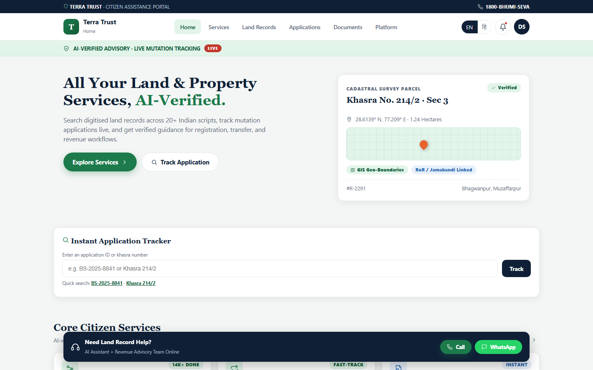

<div align="center">

# 🏛️ Terra Trust

### *AI-Verified Land Records & Citizen Services*

A citizen-services portal powered by an AI pipeline that turns old handwritten land records, across **20+ Indian scripts**, into **searchable, verified, GIS-linked** digital records.

**🏆 Smart India Hackathon 2026 Prototype**

[](https://terra-trust.onrender.com)


**[🌐 Live Demo](https://terra-trust.onrender.com)** · **[🐛 Report Bug](https://github.com/digvijay165/terra-trust/issues)** · **[✨ Request Feature](https://github.com/digvijay165/terra-trust/issues)**

<br>

<a href="https://terra-trust.onrender.com">
  
</a>

</div>

---

## 📖 About

Millions of Indian land records still exist only as **fragile, handwritten documents** in regional scripts. Getting a certified copy can take weeks of office visits.

**Terra Trust** reimagines this experience. It combines a modern **citizen-services portal**, in the style of state land-record portals, with an **AI pipeline** that digitises, verifies, and links records to GIS maps. It cuts the time to retrieve a certified copy **from two weeks to two minutes**.

> 🔗 **Try it live:** [terra-trust.onrender.com](https://terra-trust.onrender.com)

---

## 📊 Impact

| ⏱️ Retrieval time | 🎯 Accuracy | 🌐 Languages | 📉 Manual effort |
| :---: | :---: | :---: | :---: |
| **2 wks → 2 min** | **95%+** | **20+** | **~70% less** |
| Time to retrieve a certified record copy | Target field-level extraction accuracy after review | Indian languages and scripts supported | Reduction in manual data-entry effort |

---

## ✨ Features

### 🗂️ Six portal sections

| Section | What it offers |
| --- | --- |
| 🏠 **Home** | Hero, live cadastral parcel card, instant application tracker, services preview, citizen knowledge hub |
| 🧰 **Services** | Registration, mutation, records search, title check, stamp-duty calculator, dispute & zoning |
| 📜 **Land Records** | Search by **name, village, or khasra/survey number**, with language filters, scanned-document preview, extracted fields, and a **GIS map pin** |
| 📋 **Applications** | Track mutation and registration dockets with a live **4-stage progress tracker**, assigned authority, and dates |
| 📁 **Documents** | Every document linked to a citizen's verified records, with verification status |
| 🧠 **Platform** | The AI pipeline, tech stack, impact stats, and roadmap, for hackathon reviewers |

### 💡 Extra touches

- 🇮🇳 Working **EN / हिंदी** language toggle
- 🔔 Notifications dropdown and profile menu
- 📱 Mobile app-style **bottom navigation** with a "More" sheet
- 💬 Help bar with **Call** and **WhatsApp** actions
- ⚡ Quick-search examples like `BS-2025-8841` and `Khasra 214/2`

---

## 🤖 AI Pipeline

```
📄 Scan  →  🧹 Pre-processing  →  🔤 OCR + HTR  →  🏷️ Layout & NER  →  ✅ Human Verify  →  🗺️ Search & GIS
```

| Stage | What happens |
| --- | --- |
| **Scan** | Old registers and documents are scanned in bulk |
| **Pre-processing** | Images are cleaned, deskewed, and enhanced (OpenCV) |
| **OCR + HTR** | Printed and handwritten text is recognised across Indian scripts |
| **Layout & NER** | Fields such as owner, khasra number, and area are extracted (LayoutLMv3, IndicBERT) |
| **Human Verify** | Revenue officials review and approve extracted data |
| **Search & GIS** | Verified records become searchable and are linked to map parcels |

---

## 🛠️ Tech Stack

### This prototype
- **React 18** and **JavaScript**, loaded from CDN
- **Babel Standalone**: in-browser JSX, so no build step is needed
- **Custom CSS**: responsive, mobile-first design
- **Render**: static hosting

### Proposed production stack
| Layer | Technologies |
| --- | --- |
| 🔤 OCR / HTR | Tesseract, PaddleOCR, TrOCR, IndicOCR |
| 🧠 Document AI | LayoutLMv3, IndicBERT, OpenCV |
| ⚙️ Backend | FastAPI |
| 🗄️ Data & search | PostgreSQL + PostGIS, Elasticsearch, MinIO |
| ☁️ Infrastructure | Docker, Kubernetes |
| 🔐 Identity | Aadhaar-based verification |

> ℹ️ The production pipeline is described in the app's **Platform** section but is **not implemented** in this repository.

---

## 📁 Project Structure

```
terra-trust/
├── index.html                # The complete React app (single file)
├── render.yaml               # Render static-site configuration
├── terra-trust-screenshot.png
└── README.md
```

---

## 🚀 Getting Started

### Run locally

```bash
git clone https://github.com/digvijay165/terra-trust.git
cd terra-trust
python -m http.server 8080
```

Then open `http://localhost:8080`.

> 💡 You can also open `index.html` directly in a browser. An internet connection is needed to load React from the CDN.

---

## 🌐 Deployment

Terra Trust is deployed as a **Render Static Site** using the included [`render.yaml`](./render.yaml).

| Setting | Value |
| --- | --- |
| Live URL | [terra-trust.onrender.com](https://terra-trust.onrender.com) |
| Branch | `master` |
| Build command | *None* |
| Publish directory | `.` |
| Routing | All paths rewrite to `/index.html` |

---

## 🗺️ Roadmap

- [ ] 🔗 **Blockchain-anchored titles** for tamper-proof ownership records
- [ ] 🛰️ **Drone & satellite surveys** to keep parcel boundaries up to date
- [ ] 🎙️ **Voice & chat assistant** to help citizens in their own language
- [ ] ⚙️ Build the production AI pipeline (OCR/HTR, LayoutLMv3, PostGIS, Elasticsearch)

---

## ⚠️ Status

This is a **front-end prototype with mock data**, built for the **Smart India Hackathon 2026** pitch. Records, applications, and documents shown in the app are sample data and do not represent real people or land.

---

## 🤝 Contributing

Contributions, issues, and feature requests are welcome!

1. Fork the project
2. Create your branch (`git checkout -b feature/AmazingFeature`)
3. Commit your changes (`git commit -m "Add AmazingFeature"`)
4. Push to the branch (`git push origin feature/AmazingFeature`)
5. Open a Pull Request

---

## 👤 Author

**Digvijay Singh**
- GitHub: [@digvijay165](https://github.com/digvijay165)
- Portfolio: [digvijay165.github.io/portfolio](https://digvijay165.github.io/portfolio/)

---

<div align="center">

⭐ **If you like this project, give it a star!** ⭐

Made with ❤️ for **Smart India Hackathon 2026** by [Digvijay Singh](https://github.com/digvijay165)

</div>
